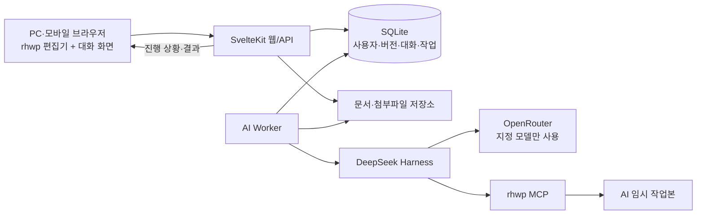

# 프로젝트 스캐폴드와 승인된 설계

승인일: 2026년 11월 6일

이 프로젝트는 사내 구성원이 HWP와 HWPX 문서를 웹에서 직접 편집하거나 AI에게 대화로 수정을 맡기는 문서 서비스다. rhwp의 웹 편집기와 MCP를 재사용하고, 사용자별 브랜치와 세션 단위 버전 관리를 제공한다.

AI 실행은 DeepSeek Harness가 담당하고, 모델 호출은 서버의 OpenRouter API 키를 사용한다. 모델은 `deepseek/deepseek-v4.1-flash-1017` 하나로 고정한다. 개인 Codex 계정 연동은 현재 설계에 포함하지 않는다.

이 문서의 스캐폴드는 승인된 목표 구조다. 실제 코드 작성 순서와 완료 기준은 [세부 코드 작성 계획](implementation-plan.md)에 정리한다.

## 서비스가 담당하는 범위

rhwp의 문서 편집 기능을 웹에 연결하고, 구성원이 직접 수정하거나 AI에 지시하는 화면을 제공한다. 이 프로젝트에서 개발할 중심 기능은 사내 사용자 관리, 문서 저장과 공유, 사용자별 브랜치, 세션 복원, AI 작업 실행과 결과 반영이다.

| 구성 요소 | 담당 범위 |
| --- | --- |
| rhwp | 문서 열기·렌더링·편집·저장과 MCP 문서 조작 |
| SvelteKit 서비스 | 인증, 문서 목록, 편집기·대화 화면, 버전 조회와 사용자 요청 처리 |
| Worker와 DeepSeek Harness | 대화 맥락에 따른 도구 호출, 임시 문서 수정, 백그라운드 작업 실행 |
| OpenRouter | 지정 DeepSeek 모델의 API 호출 |
| SQLite와 파일 저장소 | 사용자·브랜치·작업 관계와 문서·첨부파일 보존 |

각 구성 요소를 연결하는 실제 호환성은 코드 작성 계획의 2단계에서 검증한다. 기존 로컬 MCP 조작 확인은 출발점이며, 웹 편집·파일 저장·모델 도구 호출·ARM64 실행을 함께 확인한 결과를 남긴다.

## 승인된 요구사항

| 영역 | 요구사항 |
| --- | --- |
| 이용자 | 관리자에게 초대받은 사내 구성원 |
| 접속 | 별도 도메인으로 외부에서도 접속 가능 |
| 화면 | PC와 모바일 지원. 모바일은 AI 지시와 결과 확인 중심이며 간단한 직접 편집도 제공 |
| 직접 편집 | rhwp 웹 편집기가 제공하는 범위를 초기 기준으로 사용 |
| 문서 형식 | HWP와 HWPX 업로드 및 저장·다운로드 |
| 공유 | 모든 구성원이 문서·버전·문서 편집용 AI 대화 이력을 열람 가능 |
| 편집 권한 | 모든 구성원이 모든 문서를 편집할 수 있으며, 수정은 본인의 브랜치에서 수행 |
| AI 기능 | 기존 문서 수정, 새 문서 작성, 선택한 문장·문단·표 수정 |
| 참고 자료 | PDF·이미지·다른 HWP/HWPX 파일 첨부 |
| 작업 지속 | 브라우저를 닫거나 접속이 끊겨도 AI 작업 계속 실행 |
| 동시 작업 | 한 사용자가 여러 문서의 AI 작업을 동시에 실행 가능 |
| 브랜치 | 문서별 사용자당 하나. 같은 사용자는 같은 브랜치에서 계속 작업 |
| 버전 | 세션 단위 복원, 브랜치·버전 트리, 버전 간 변경 내용 비교 |
| 대표 버전 | 사용자가 명시적으로 반영한 버전을 문서의 기본 화면으로 표시 |
| 다른 사람의 변경 | 내 브랜치에 자동으로 적용하지 않고 사용자가 가져올 시점 선택 |
| 병합 | 초기 버전에는 브랜치 병합을 제공하지 않음 |
| AI와 직접 편집 | AI 임시 작업본을 분리. 편집이 겹치면 두 결과를 보관하고 사용자가 선택 |
| 이력 정리 | 기본 30일, 관리자 변경 가능. 대표 버전과 각 브랜치 최신 버전 보존 |
| 백업 | 초기 버전은 수동 백업·복원 |
| 서버 | 라즈베리파이 5 |
| DB | SQLite |
| 코드 스타일 | 직접 작성·수정하는 코드와 설정은 공백 4개 들여쓰기 |

## 기술 구성

| 영역 | 구성 |
| --- | --- |
| 웹 화면과 API | 기존 SvelteKit 3·Svelte 5·TypeScript 유지 |
| UI | 기존 Tailwind CSS 4·shadcn-svelte 활용 |
| 웹 배포 | SvelteKit Node 어댑터 |
| 문서 편집 화면 | `@rhwp/editor` 임베드 |
| DB 접근 | SQLite + Drizzle ORM + `better-sqlite3` |
| 파일 저장 | 서버 파일시스템 |
| AI 실행 | 독립 Worker + DeepSeek Harness TypeScript SDK |
| 모델 API | OpenRouter |
| 모델 | `deepseek/deepseek-v4.1-flash-1017` |
| 문서 도구 | rhwp MCP |
| 작업 대기열 | SQLite에 저장하는 영속 작업 대기열 |
| 진행 상황 전달 | SSE |
| 프로세스 운영 | systemd |
| 외부 접속 | HTTPS reverse proxy |

DeepSeek Harness SDK는 별도 프로세스의 Harness에 세션과 프롬프트를 전달하고 실행 이벤트를 받을 수 있다. 이 연결을 Worker의 어댑터 안에 둔다. [공식 SDK 구조](https://github.com/deepseek-ai/deepseek-harness/blob/master/packages/sdk/README.md)

Harness의 외부 모델 API 설정으로 OpenRouter를 연결하고, MCP 클라이언트로 rhwp 도구를 연결한다. 의존성 버전은 통합 검증 후 고정한다. [모델 API 설정](https://github.com/deepseek-ai/deepseek-harness/blob/master/docs/user/guide/providers.md), [MCP 클라이언트](https://github.com/deepseek-ai/deepseek-harness/blob/master/packages/mcp/mcp-client/README.md)

## 실행 구조



웹 서버는 사용자 인증, 문서 조회, 작업 요청과 결과 표시를 담당한다. Worker는 DB에 기록된 작업을 가져가서 Harness와 rhwp를 실행하고 결과를 저장한다. 브라우저 연결의 종료는 Worker 작업을 종료시키지 않는다.

SQLite에는 문서와 버전의 관계, 작업 상태, 대화와 진행 이벤트를 저장한다. 문서 바이트와 첨부파일은 파일시스템에 저장하고, DB가 저장 위치를 가리킨다. Harness 내부 실행 기록은 서비스의 문서 버전과 별도로 관리한다.

## 목표 디렉토리 구조

```text
deepet-hwpx-cowork/
├── AGENTS.md
├── .editorconfig
├── .gitattributes
├── .env.example
├── .gitignore
├── package.json
├── pnpm-lock.yaml
├── vite.config.ts
├── tsconfig.json
├── tsconfig.worker.json
├── drizzle.config.ts
├── README.md
├── docs/
│   ├── architecture.md
│   ├── implementation-plan.md
│   └── git.md
├── src/
│   ├── app.html
│   ├── app.css
│   ├── app.d.ts
│   ├── hooks.server.ts
│   ├── routes/
│   │   ├── +layout.svelte
│   │   ├── +page.server.ts
│   │   ├── (auth)/
│   │   │   ├── login/
│   │   │   └── invite/[token]/
│   │   ├── (app)/
│   │   │   ├── +layout.server.ts
│   │   │   ├── +layout.svelte
│   │   │   ├── documents/
│   │   │   │   └── [documentId]/
│   │   │   ├── jobs/
│   │   │   └── admin/
│   │   │       ├── members/
│   │   │       └── settings/
│   │   └── api/
│   │       ├── auth/
│   │       ├── documents/
│   │       ├── sessions/
│   │       ├── attachments/
│   │       ├── jobs/
│   │       ├── events/
│   │       └── health/
│   └── lib/
│       ├── components/
│       │   ├── ui/
│       │   ├── shell/
│       │   ├── documents/
│       │   ├── editor/
│       │   ├── chat/
│       │   ├── versioning/
│       │   └── jobs/
│       ├── client/
│       │   ├── api.ts
│       │   ├── events.ts
│       │   └── rhwp-bridge.ts
│       ├── contracts/
│       │   ├── document.ts
│       │   ├── version.ts
│       │   ├── session.ts
│       │   ├── job.ts
│       │   └── events.ts
│       └── server/
│           ├── config/
│           ├── auth/
│           ├── db/
│           │   ├── client.ts
│           │   ├── schema/
│           │   └── repositories/
│           ├── storage/
│           ├── services/
│           │   ├── documents.ts
│           │   ├── branches.ts
│           │   ├── versions.ts
│           │   ├── sessions.ts
│           │   ├── attachments.ts
│           │   └── retention.ts
│           └── jobs/
│               ├── queue.ts
│               ├── leases.ts
│               └── events.ts
├── worker/
│   ├── index.ts
│   ├── dispatcher.ts
│   ├── runtime/
│   │   ├── harness.ts
│   │   ├── model-policy.ts
│   │   ├── mcp.ts
│   │   ├── workspace.ts
│   │   └── session-store.ts
│   ├── tasks/
│   │   ├── edit-document.ts
│   │   ├── create-document.ts
│   │   ├── compare-versions.ts
│   │   └── cleanup.ts
│   └── results/
│       ├── validate.ts
│       └── apply.ts
├── config/
│   └── harness/
├── migrations/
├── scripts/
│   ├── create-admin.ts
│   ├── backup.ts
│   └── restore.ts
├── tests/
│   ├── unit/
│   ├── integration/
│   ├── e2e/
│   └── fixtures/
├── deployment/
│   ├── rpi_server.md
│   ├── Caddyfile
│   └── systemd/
│       ├── deepet-web.service
│       └── deepet-worker.service
└── data/
    ├── app.sqlite
    ├── versions/
    ├── workspaces/
    ├── jobs/
    ├── attachments/
    └── harness/
```

`data/`는 실행 데이터이며 소스 관리에서 제외한다. 배포 환경에서는 설정한 데이터 루트를 사용한다. API 키는 서버 환경 설정으로 공급하고 브라우저에 전달하지 않는다.

공개 소스 저장소는 [Longcat2957/hwpx-cowork](https://github.com/Longcat2957/hwpx-cowork)이며 `main` 브랜치를 기준으로 관리한다. 실제 서버 접속 정보는 Git에서 제외하는 `deployment/rpi_server.local.md`에 보관한다. 공통 운영 계획은 [라즈베리파이 문서](../deployment/rpi_server.md), 소스 관리 규칙은 [Git 설정 문서](git.md)를 따른다. 서비스 내부의 문서 브랜치는 SQLite와 파일 저장소로 관리한다.

## 주요 데이터와 책임

| 개념 | 책임 |
| --- | --- |
| 문서 | 목록에 하나로 표시되는 문서이며 대표 버전을 가리킴 |
| 브랜치 | 문서별 사용자당 하나. 자신의 작업 이력을 유지 |
| 버전 | 세션 단위로 복원 가능한 파일과 작성자·부모 버전 정보 |
| 편집 작업본 | 사용자가 현재 직접 편집하는 파일 |
| AI 임시 작업본 | AI가 독립적으로 수정하는 파일 |
| 편집 세션 | 기준 버전과 작업본의 수정 상태를 관리 |
| 대화 세션 | 편집 세션에 연결된 사용자 지시·응답·도구 실행 이력 |
| 작업 | Worker가 실행하는 요청과 결과, 진행 상태 |

DB의 중심 테이블은 `users`, `invitations`, `auth_sessions`, `documents`, `branches`, `versions`, `editing_sessions`, `chat_sessions`, `messages`, `attachments`, `jobs`, `job_events`다. 비용과 보관 설정을 위한 테이블은 세부 구현 계획에서 추가한다.

## 버전과 결과 반영 규칙

1. 문서와 사용자 조합마다 브랜치 하나만 만든다.
2. 사용자는 자신의 브랜치에서 작업하며 다른 구성원의 브랜치를 직접 덮어쓰지 않는다.
3. 세션의 수정 전 상태를 복원점으로 보관한다. 키 입력이나 개별 도구 호출마다 사용자용 버전을 만들지 않는다.
4. 보관된 버전 파일은 변경하지 않는다. 직접 편집과 AI 편집은 작업본에서 수행한다.
5. AI 작업은 시작 시점의 기준 버전과 작업본 수정 번호를 기록한다.
6. AI 완료 시 작업본이 그대로이면 결과를 자신의 작업본에 적용한다. 변경되었다면 직접 편집본과 AI 결과를 보관하고 사용자가 선택한다.
7. 작업본에 AI 결과를 적용하는 동작과 문서의 대표 버전을 지정하는 동작을 구분한다. 대표 버전은 사용자가 명시적으로 지정한다.
8. 다른 사람의 대표 버전을 가져올 때도 기존 작업을 복원할 수 있게 보관하며, 브랜치 병합을 수행하지 않는다.
9. 다른 사람의 대표 버전 변경은 내 브랜치에 자동으로 적용하지 않는다.
10. 30일 정리 정책은 대표 버전, 브랜치 최신 버전과 진행 중 작업의 참조를 보호한다.

## 문서 편집 흐름 예시

철수와 영희가 같은 문서를 열면 문서 목록에는 하나의 항목이 보인다. 두 사람이 편집을 시작하면 각각의 브랜치가 생기고, 철수가 다음 날 작업을 이어가면 기존 철수 브랜치를 사용한다.

철수가 새 대화 세션에서 수정을 요청하면 세션 시작 상태를 복원점으로 보관한다. AI는 별도의 임시 파일을 수정한다. 그동안 철수의 작업본이 그대로이면 AI 결과를 적용하고, 직접 편집이 있었다면 직접 편집본과 AI 결과를 모두 보관해 선택하게 한다. 브라우저의 미저장 입력도 결과 적용 과정에서 보존한다.

철수는 결과를 확인한 뒤 원하는 버전을 대표 버전으로 지정할 수 있다. 영희의 기존 브랜치는 그대로 유지되며, 영희가 원하는 시점에 그 버전을 가져올 수 있다. 세션 롤백은 기존 이력을 보존한 상태로 수행한다.

문서마다 새 브랜치를 만드는 기준은 사용자가 달라질 때다. 같은 사용자의 세션별 변화는 기존 브랜치 안의 버전으로 기록한다. 작업 중 자동 저장은 작업본을 갱신하며, 키 입력마다 버전 트리의 항목을 추가하지 않는다.

## 코드와 모듈 경계

- 들여쓰기는 공백 4개를 사용한다. `.editorconfig`와 `AGENTS.md`에 같은 규칙을 둔다.
- 브라우저가 가져오는 코드는 `components/`, `client/`, `contracts/`를 사용한다. 인증·DB·비밀 설정은 `server/`에 둔다.
- 웹 서버와 Worker가 공유하는 서버 코드는 SvelteKit 요청 객체나 전용 환경 모듈에 의존하지 않게 작성한다.
- rhwp 브라우저 연결은 `rhwp-bridge.ts`, Harness 연결은 `worker/runtime/harness.ts`에 모은다.
- `model-policy.ts`에서 모든 LLM 요청에 고정 모델을 적용한다. 요약과 보조 작업도 동일하며 다른 모델로 자동 전환하지 않는다.
- SQLite 트랜잭션은 상태 변경에 사용하고, 외부 API 호출이나 문서 편집이 끝날 때까지 열어두지 않는다.
- 실행 중 AI 작업은 작업별 파일 접근 범위를 갖는다. 사용자 구분과 접근 제어는 서비스가 담당한다.

## 참고 문서

- [rhwp 웹 편집기](https://github.com/edwardkim/rhwp#npm-패키지--웹에서-바로-사용하기)
- [OpenRouter 지정 모델](https://openrouter.ai/deepseek/deepseek-v4.1-flash-1017)
- [SvelteKit Node 배포](https://svelte.dev/docs/kit/adapter-node)
- [Drizzle SQLite 연결](https://orm.drizzle.team/docs/sqlite/get-started-sqlite)
